<p align="center">
  <a href="https://furkiozknn.github.io/cay-ocagi/">
    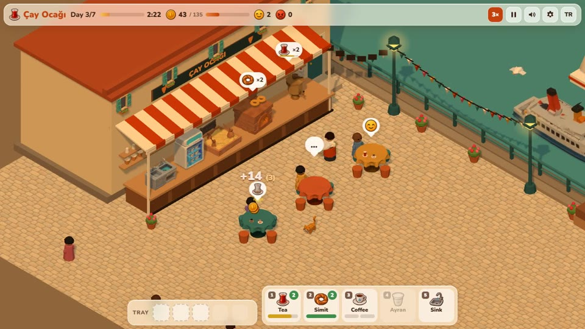
  </a>
</p>

<p align="center">
  <a href="https://furkiozknn.github.io/cay-ocagi/"></a>
</p>

<p align="center">
  
  
  <a href="LICENSE"></a>
  
</p>

<!-- portals:start -->
<p align="center">
  Also on: <a href="https://furkiozknn.itch.io/cay-ocagi"><strong>itch.io</strong></a> &middot; <a href="https://playgama.ai/play/ysmjlykfbkbjew"><strong>Playgama</strong></a>
</p>
<!-- portals:end -->

<p align="center">
  <strong>A 3D time-management game on a low-poly Istanbul quay: run a tiny tea house for seven busy days, brew tea, warm simit, cook Turkish coffee without letting it boil over and serve every table before patience runs out.</strong>
</p>

<!-- gameplay gif -->

## Features

- **Seven-day shift & endless mode:** Serve across 7 busy days with coin targets climbing from 65 coins on day 1 to 250 on day 7, unlocking a new menu item each of the first 4 days, special guests (a hurried worker, a party of 3, and a regular tipping double), followed by an endless shift after day 7.
- **Four items, five busy stations:** Tea brews in 7 s (yielding 4 glasses with a 25 s freshness window), the oven warms 3 simit at a time, Turkish coffee cooks in 4.2 s with a 3.6 s pickup window before boiling over, ayran serves instantly, and dirty glasses head to the sink with up to 6 queued clicks.
- **Between-day shop & upgrades:** Reinvest earnings between shifts into a second semaver, an expanded tray (3 to 5 slots), a faster oven, up to 3 extra tables, an apprentice table-clearer, and comfy stools (+20% patience per level) to earn 1 to 3 stars.
- **Ferry rush & living Istanbul quay:** Weather sudden ferry rushes (2 to 3 arriving parties within 10 s, warned 8 s ahead by horn), shoo gull thieves before they snatch simit, serve tavla regulars every 14 to 18 s, and enjoy a living quay with ferry, gulls, cat, and Web Audio Turkish music.
- **Ultra-lean web performance:** 60 fps on an Intel UHD GPU at 1280x720 with 31 draw calls (34 max) and ~50k triangles on day 6, verified by an automated bot winning 84 of 90 seeded games (and 86 of 90 in v2 benchmark) with 0 JS errors.

## How to play

> [!TIP]
> **Goal:** Earn each day's coin target before closing time (65 coins on day 1, 250 on day 7) and clear all seven days. More coins and more happy customers give up to 3 stars; after day 7 the endless shift begins.

1. **Take orders & prepare:** Customers take a free table and show an order bubble with a patience ring. Click a station (`1`–`5`) or its button to brew tea, warm simit, cook Turkish coffee, or pour ayran.
2. **Collect & serve:** Click ready items to add them to your tray (holds 3 to 5 items), then click the customer's table to serve; the waiter walks to each target in queue (up to 6 clicks).
3. **Clear & wash:** When a party finishes eating, click the table to clear dirty glasses and take them to the sink before new customers can sit.

<details>
<summary><b>Rules and mechanics</b></summary>

- **Day duration & last orders:** A day lasts 3 minutes of game time. "Last orders" is called 20 s before closing and the clock turns red; tables still eating when the day ends pay their bill and tip.
- **Preparation times:** Tea brews for 7 s and yields 4 glasses (fresh for 25 s; stale tea is greyer and pays half tip). The oven warms 3 simit at a time and speeds up with upgrades. Turkish coffee cooks for 4.2 s and must be picked up within 3.6 s (perfect grab in the first second gives a tip bonus), or it boils over. Ayran pours instantly.
- **Tray & queue:** The tray holds 3 items (expandable to 5 in the shop). Clean items can be dropped by clicking their tray slot; dirty glasses must go to the sink. You can queue up to 6 clicks.
- **Star rating:** 1 star for reaching the coin target, 2 stars for 125% target with at least 70% happy customers, 3 stars for 150% target with at least 88% happy customers.
- **Retries & shop:** A failed day keeps earned coins, and retry routes through the shop so you can buy upgrades before trying again.
- **Ferry rush & gulls:** From day 3, ferry horn signals a rush (8 s warning) bringing 2 to 3 parties within 10 s. Gulls land on the quay rail and dive for served simit; tap or click to shoo them away before coins are lost.
- **Regulars:** Regulars stay ~2.5x longer, display a dice icon, and request "one more tea" every 14 to 18 s, adding tips and streak bonuses.

</details>

### Controls

| Action | Mouse / touch | Keyboard |
|---|---|---|
| Use a station (brew, collect, wash) | Click / tap station or button | `1`–`5` |
| Serve or clear a table | Click / tap table or order bubble | |
| Drop clean item from tray | Click / tap tray slot | |
| Clear waiter's queue | Right-click | `Backspace` |
| Pan / zoom | Drag / wheel or pinch | |
| Speed 1x / 2x / 3x | Speed button | |
| Pause menu | Pause button | `P` / `Esc` / `Space` |
| Music / effects / language | Settings | `M` / `X` / `L` |
| Fullscreen | Settings | `F11` |

- **Audio & hotkeys:** `M` mutes/unmutes music, `X` toggles sound effects, `L` cycles language (TR / EN), `P` / `Esc` / `Space` pauses.
- **Touch & mobile:** Fully playable on phone or tablet with responsive tap controls, pinch-to-zoom, and touch drag.
- **Persistence:** Settings (master, music and effects volume, TR / EN, Low / High quality, fullscreen) are saved in `localStorage` under `arena.cay.settings`; the run under `arena.cay.save` (saved at day start and shop visits for **Continue**), and best results under `arena.cay.best`. Changing quality reloads the page. First visit follows browser language.

<details>
<summary><b>URL flags for testing</b></summary>

| Flag | Effect |
|---|---|
| `?auto` | The game plays itself at 3x speed (takes orders, prepares, serves, clears tables, buys upgrades) |
| `?debug` | Draw calls, FPS, and JS errors on screen; `window.caySim(seconds)` fast-forwards the simulation |
| `?sim=N` | Fast-forward N seconds before the first frame |
| `?bench=N` | Run N full bot games and record per-day results |
| `?low` | No shadows, pixel ratio 1 |
| `?noassets` | The original procedural look, without generated models, icons, and textures |
| `?nosave` | Do not read or write the saved run (implied by `?auto` and `?bench`) |
| `?day=N` | Start a new game on day N, with 150 coins per skipped day |
| `?lang=en` / `?lang=tr` | Start language |
| `?seed=N` | Fixed simulation seed |
| `?selftest` | Run v2 mechanics checks by simulation; results in `window.cay.selfTest` |

`window.cay` exposes live state (`day`, `clock`, `coins`, `target`, `tables`, `waiter`, `rushes`, `refill`, `gull`, `thief`, `perfects`, `trayFresh()`, `errors`).

</details>

## Screenshots

<table>
  <tr>
    <td width="33%">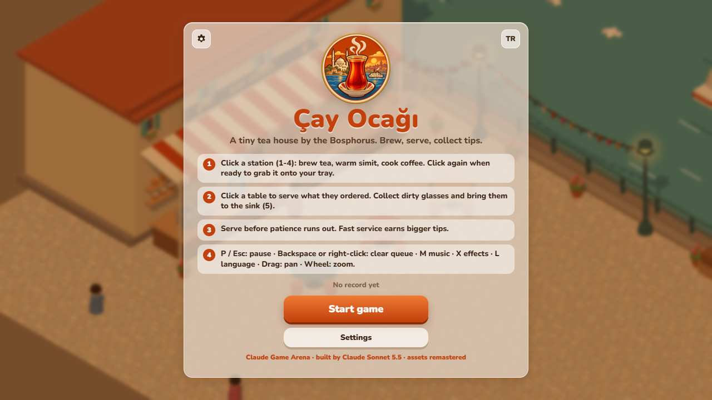<br><sub>Title screen</sub></td>
    <td width="33%">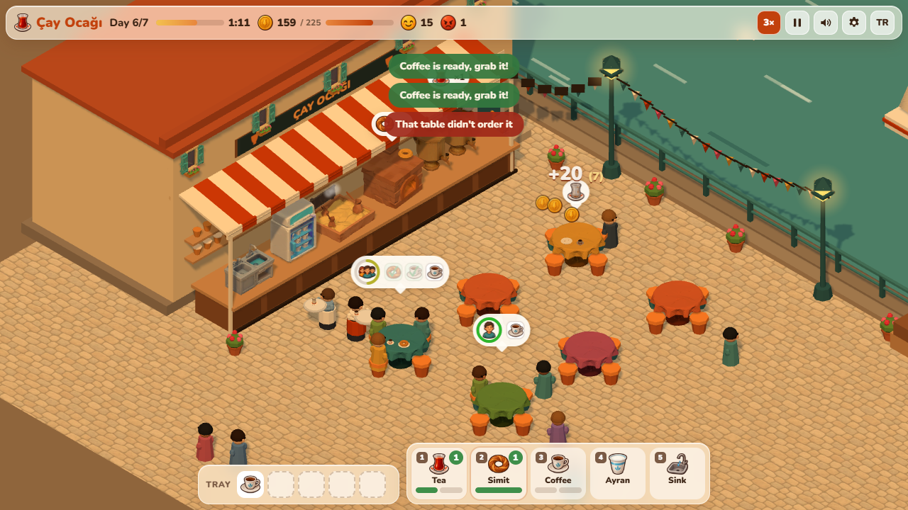<br><sub>A busy day 6</sub></td>
    <td width="33%">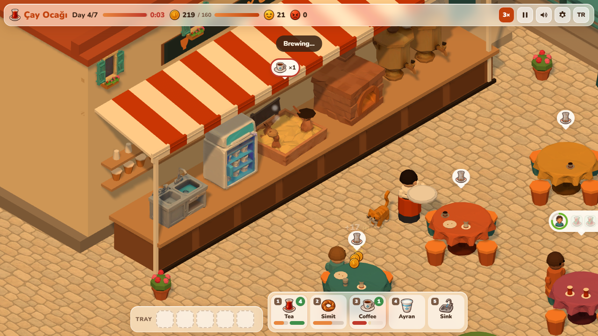<br><sub>The counter and its stations</sub></td>
  </tr>
  <tr>
    <td>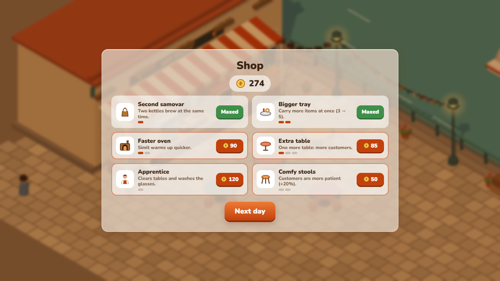<br><sub>The shop between days</sub></td>
    <td>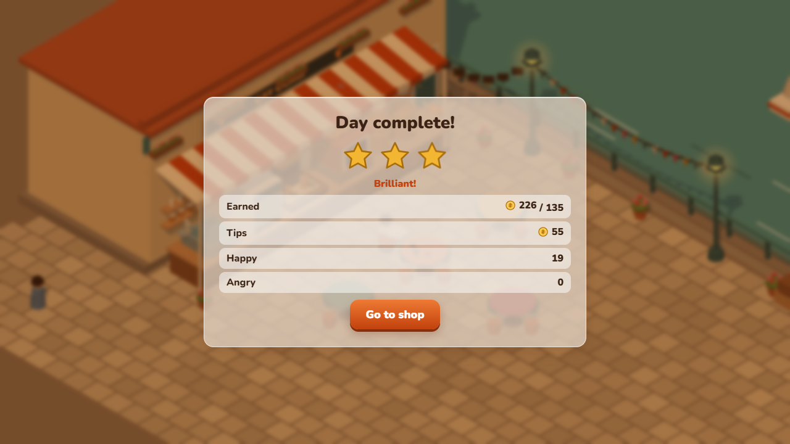<br><sub>Day complete, three stars</sub></td>
    <td>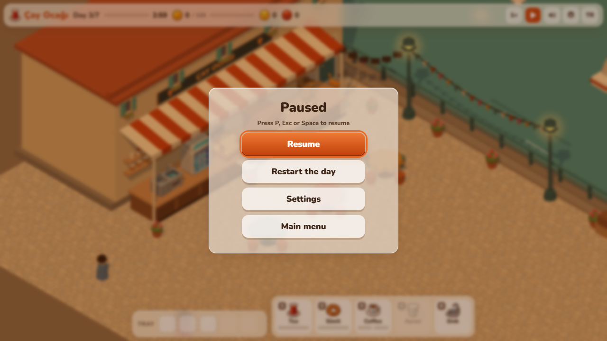<br><sub>Pause menu</sub></td>
  </tr>
  <tr>
    <td>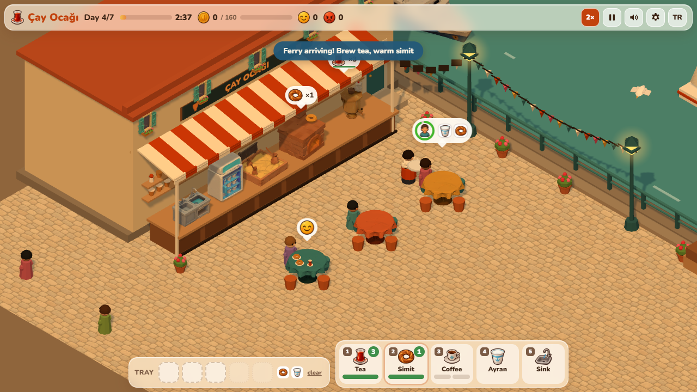<br><sub>Ferry rush warning</sub></td>
    <td>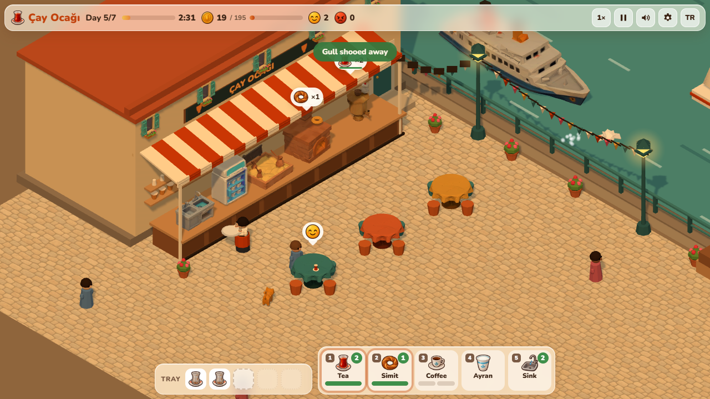<br><sub>Gull thief</sub></td>
    <td>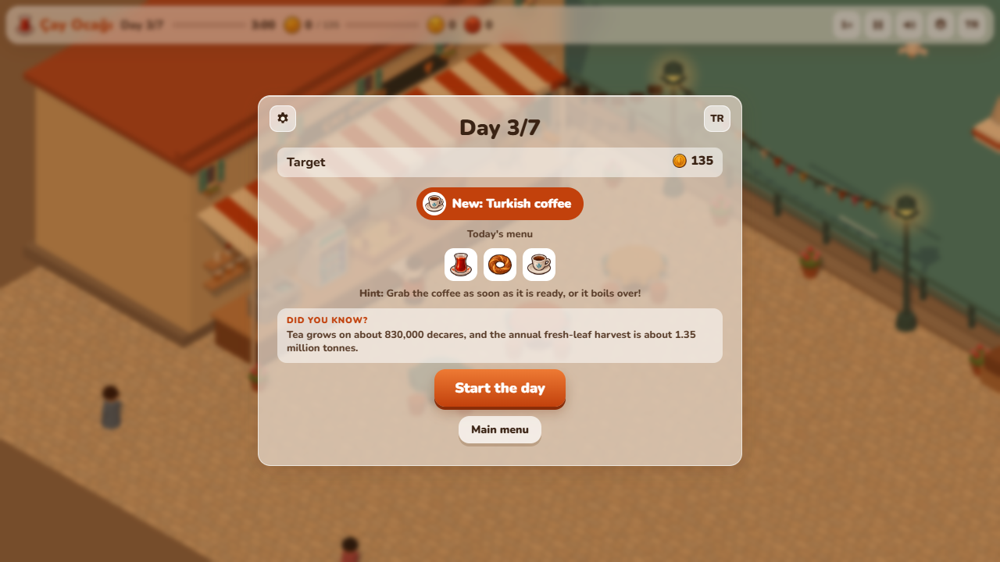<br><sub>Day briefing and fact card</sub></td>
  </tr>
</table>

<details>
<summary><b>Settings, close-up and the phone layout</b></summary>

<table>
  <tr>
    <td width="50%">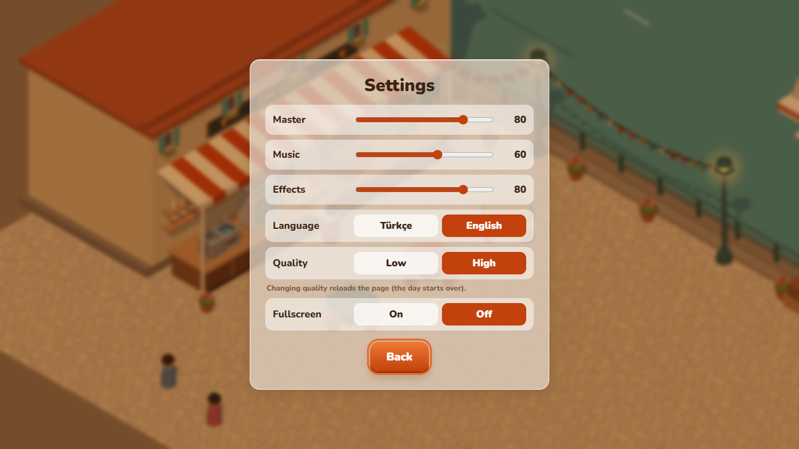<br><sub>Settings</sub></td>
    <td width="50%">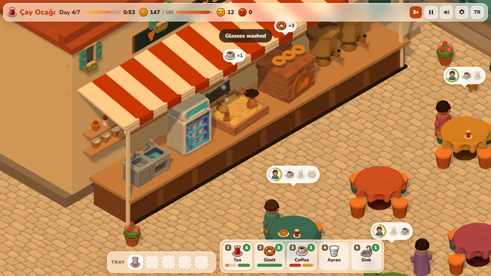<br><sub>Zoomed in on day 4</sub></td>
  </tr>
  <tr>
    <td>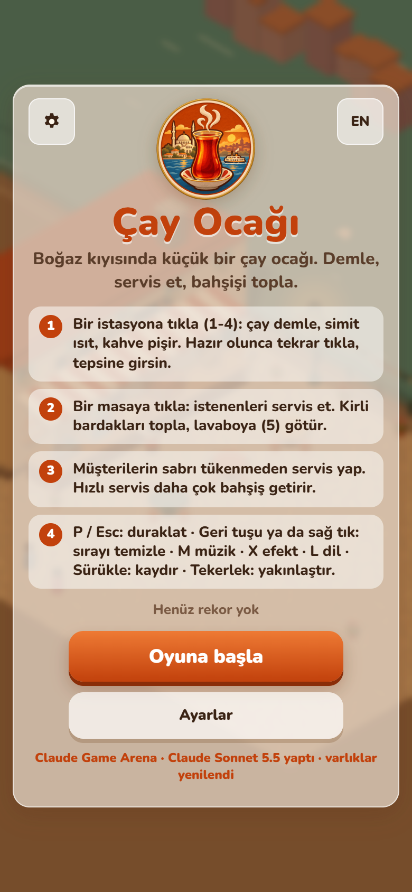<br><sub>Phone, title in Turkish</sub></td>
    <td>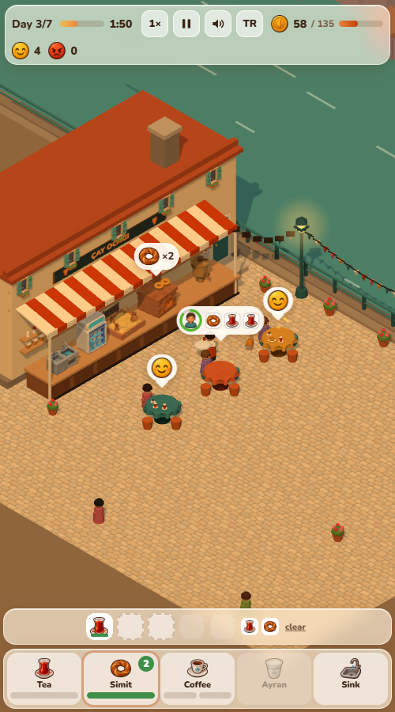<br><sub>Phone, day 3</sub></td>
  </tr>
</table>

</details>

## Redesign & Performance

**Art direction:** Cozy hand-painted 2.5D. Walnut `#5B3A29`, tea amber `#B5651D`, brass `#C9A227`, cream `#F4E9D8`, and tile teal `#2E7D7A`, lit by a warm low key light with lamp pools and a cool rim. Redesigned by Claude Sonnet 5.5; gameplay, saves, flags, and the `?auto` bot are untouched.

**Visual updates (rules, controls, bot, and saves are untouched):**
- **World:** Brush-stroke texture sampled by world position on all static geometry, a teal and cream tiled terrace with a kilim rug under each table, a teal tile band on the wall, a graded turquoise-to-indigo strait with a foam line, twinkling string lights, a bench, barrels, crates, and lemon trees.
- **Characters and FX:** Customers and the waiter get trousers, belts, collars, and ears plus squash-and-stretch idles (stride bounce, breathing, angry shiver); tea glasses glow, glint, and send up steam wisps; lamps flicker.
- **UI:** Carved-walnut frames with brass bolts, cream paper panels, brass buttons, serif headings, and teal accents on every screen (title, briefing, summary, shop, pause, settings, toasts); contrast checked at 4.5:1 or better.

**Measured on an Intel UHD GPU (i5-10210U, 1280x720):**
- Draw calls: 31 calls (34 at most) on a busy day 6; ~50k triangles
- Page rAF: 59 to 60 fps (rock-solid 60 fps on `?low` and with `?noassets`)
- QA verification: 0 console/JS errors across desktop, phone, and phone landscape (light and dark themes)
- Bot balance: `?auto` won 11 of 12 games in `?auto&bench=12`, 84 of 90 across three seed bases, and 86 of 90 in v2 benchmark (`?auto&bench=90`); reached endless shift up to day 9 with 0 JS errors.
- Note: A tea-glass icon set was not redone, and earlier gallery images show the pre-redesign look.

## Running locally

Serve the folder over HTTP (opened from `file://`, the browser blocks the model files and the game uses its procedural models with the generated icons):

```bash
python -m http.server 8000
```

Then open <http://localhost:8000/>.

## Made with Claude Code

Built by **Claude Sonnet 5.5** with Claude Code from one prompt: [prompts/cay-ocagi.md](prompts/cay-ocagi.md). The first version made everything in code: the tea house, the street, the customers and the waiter are merged or instanced low-poly primitives with vertex colours, and every sound is synthesised with the Web Audio API. A small hicaz music loop with a frame drum was added later, also in Web Audio.

The assets were remastered by the orchestrator, **Claude Opus 5.5**, with generated models and images: Tripo text-to-3D (through Higgsfield) for the semaver, simit oven, coffee sand stove, ayran cooler, sink, tables, façade windows, ferry and cat, and GPT Image for a 20-icon sheet, the logo and the cobblestone texture. The models were processed with glTF-Transform (about 0.9 MB in `assets/`); the served items (tea glass, simit, coffee and ayran cups) became small models built in code, and every procedural part stays as the fallback. Prompts, sizes, the rejected asset and the before and after measurements: [docs/assets.md](docs/assets.md). A Godot 4 remake was made in round 2.

### v2 update

Upgraded by **Claude Sonnet 5.5** with Claude Code from [prompts/cay-ocagi-v2.md](prompts/cay-ocagi-v2.md).

- **Straight into day 1:** Play starts the first shift at once; three pulsing coach marks (tea station, first customer, table) advance on the real action and show once. Later days keep their briefing. Repeated toasts refresh instead of stacking.
- **Ferry rush (from day 3):** The ferry's horn is the warning ("Ferry arriving", 8 s ahead); then 2 to 3 parties step off within 10 s. The day's customer count stays the same, the rush only moves arrivals together.
- **Tea freshness:** A poured glass is fresh for 25 s, then its bar fades; stale tea is greyer, pays half the tip and draws a grumble. A pot left on the counter until cold is tipped out and re-brewed.
- **Regulars play tavla:** After the first serve a regular stays about 2.5x longer, shows a dice icon and asks for "one more tea" every 14 to 18 s; each refill adds tip and a small streak.
- **Gull thieves (from day 3):** A gull lands on the quay rail, then dives at a served simit; click or tap it to shoo it away, otherwise that simit's coins are lost. One gull at a time, never in the first 20 s.
- **Facts and ranks:** A "Did you know?" card on each day briefing and summary (six sourced facts, see [CREDITS.md](CREDITS.md)) and a cosmetic rank from lifetime coins: Çırak, Kalfa, Usta. A sleeping Van kitten sits on the shop and summary screens.
- **Order urgency:** Bubbles shake and redden in the last quarter of patience, the coffee pot shows a shrinking ring during its 3.6 s window and a perfect grab (first second) rings a bell and adds a tip.
- **Extended simulation state:** `window.cay` exposes `rushes`, `refill`, `gull`, `thief`, `trayFresh()`, and `perfects`; `?selftest` runs the new mechanics by simulation. The `?auto` bot still wins 86 of 90 seeded games in `?auto&bench=90`.

<details>
<summary><b>Technical notes and simulation architecture</b></summary>

- **Simulation tables (`PRICE`, `CUST`, `DAYS`, `UPG`):** Prices, brewing and cooking times, customer types, the 7 days, and shop progression are data tables at the top of the simulation.
- **Bot testing:** The `?auto` waiter acts through identical player simulation events: takes orders, prepares, collects, delivers, clears tables, and purchases upgrades at the between-day shop.
- **Asset pipeline:** Low-poly models processed via glTF-Transform (~0.9 MB total in `assets/`), with seamless procedural primitives as a fallback under `?noassets` or `file://` protocol.
- **Audio engine:** Fully synthesized Web Audio API sounds for boiling, clinking glasses, coin drops, and ambient water, accompanied by a procedural hicaz music loop with frame drum.

</details>

### Claude Game Arena

Çay Ocağı is part of the **Claude Game Arena** series, where each game is built by a Claude model from one prompt.

[Hisar](https://furkiozknn.github.io/kale-savunmasi/) · [Çini Ustası](https://furkiozknn.github.io/cini-ustasi/) · [Martı](https://furkiozknn.github.io/marti/) · [Kervan](https://furkiozknn.github.io/kervan/) · [Dolmuş](https://furkiozknn.github.io/dolmus/) · [Peri Golf](https://furkiozknn.github.io/peri-golf/) · [Mehter](https://furkiozknn.github.io/mehter/) · [Boğaz Vapuru](https://furkiozknn.github.io/bogaz-vapuru/) · [Simit Fırını](https://furkiozknn.github.io/simit-firini/) · [Karagöz](https://furkiozknn.github.io/karagoz/) · [Lale Bahçesi](https://furkiozknn.github.io/lale-bahcesi/)

**Round 5:** [Kapadokya Balonu](https://furkiozknn.github.io/kapadokya-balonu/) · [Ebru](https://furkiozknn.github.io/ebru/) · [Kırkpınar](https://furkiozknn.github.io/kirkpinar/) · [Çarşı Kaçışı](https://furkiozknn.github.io/carsi-kacisi/)

**Round 6:** [Topkapı Gecesi](https://furkiozknn.github.io/topkapi-gecesi/) · [Hamsi](https://furkiozknn.github.io/hamsi/) · [Pamukkale](https://furkiozknn.github.io/pamukkale/) · [Mimar Sinan](https://furkiozknn.github.io/mimar-sinan/)

## License

MIT, see [LICENSE](LICENSE).

Like the game? You can support new rounds on [Buy Me a Coffee](https://buymeacoffee.com/furkiozkann). The game stays free.
