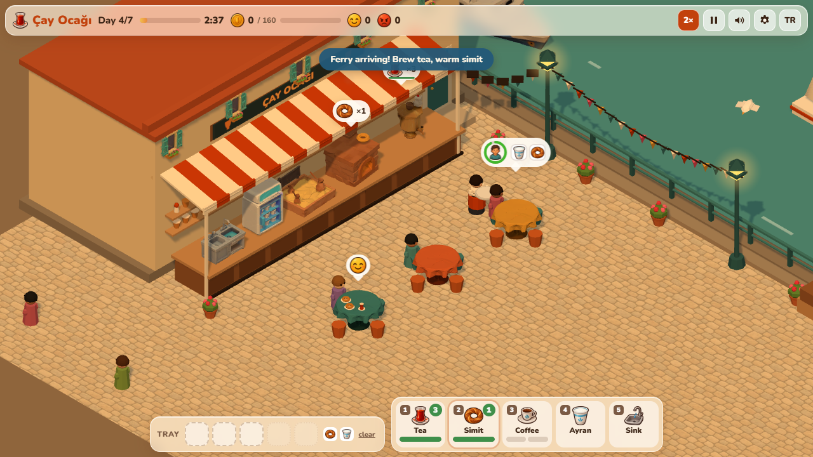
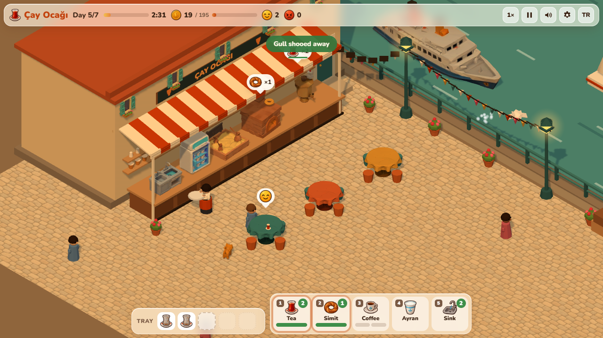
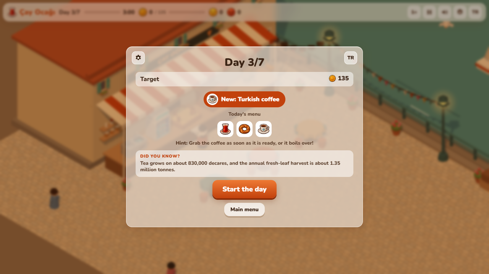
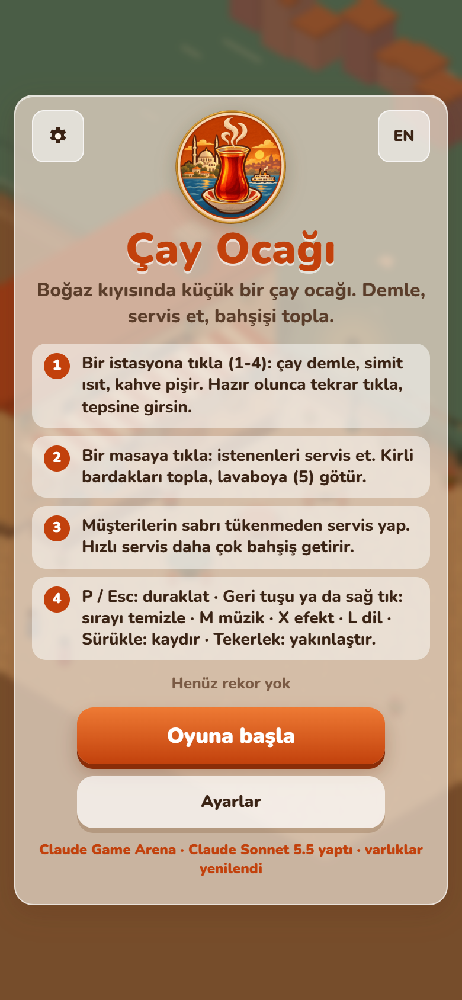

<p align="center">
  <a href="https://furkiozknn.github.io/cay-ocagi/"></a>
</p>

<p align="center">
  <a href="https://furkiozknn.github.io/cay-ocagi/"></a>
  
  
  <a href="LICENSE"></a>
  
</p>

<p align="center"><b>A 3D time-management game on a low-poly Istanbul quay: run a tiny tea house for seven busy days, brew tea, warm simit, cook Turkish coffee without letting it boil over and serve every table before patience runs out.</b></p>

<p align="center">
  
</p>

<p align="center"><b>Play online: <a href="https://furkiozknn.github.io/cay-ocagi/">https://furkiozknn.github.io/cay-ocagi/</a></b> (desktop and phone, no install)</p>

<!-- portals:start -->
<p align="center">Also on: <a href="https://furkiozknn.itch.io/cay-ocagi">itch.io</a></p>
<!-- portals:end -->

## Highlights

- **Four items, five stations.** Tea brews in the semaver, simit warms in the oven, Turkish coffee has to be grabbed
  in time or it boils over, ayran is instant, and dirty glasses go to the sink.
- **Seven days, each with something new.** A new menu item on each of the first four days, then a hurried office
  worker with little patience, a group of three and a regular who tips double; after day 7 comes an endless shift.
- **A shop between days.** A second semaver, a bigger tray (3 to 5 items), a faster oven, up to three extra tables, an
  apprentice who clears tables and comfy stools (+20 % patience per level).
- **Tips depend on speed.** Customers who wait too long leave angry, customers who find no free table walk by, and the
  day's coins and happy guests decide 1 to 3 stars.
- **A living street.** A ferry crossing the strait, gulls, lamp posts, bunting, geraniums and a ginger cat you can pet.
- **Balanced by a bot.** The `?auto` waiter plays with the same actions as a player and won 84 of 90 seeded games
  ([measurements](docs/assets.md)).
- **Light on a laptop GPU.** 60 fps on an Intel UHD GPU at 1280x720 on a busy day 6, with 31 draw calls and about 50 k
  triangles.

## How to play

> [!TIP]
> **Goal:** earn each day's coin target before closing time (65 coins on day 1, 250 on day 7) and clear all seven days.
> More coins and more happy customers give up to 3 stars; after day 7 the endless shift begins.

Customers take a free table and show an order bubble with a patience ring. Click a station to start an item or to
collect it onto your tray, then click the table to serve it; the waiter walks to each target in order. When a party has
eaten, clear its glasses and take them to the sink before the table can be used again.

<details>
<summary><b>More rules</b></summary>

- A day lasts 3 minutes of game time. "Last orders" is called 20 s before closing and the clock turns red; tables that
  are still eating when the day ends pay their bill and tip.
- Tea brews for 7 s and gives 4 glasses. The oven warms 3 simit at a time and gets faster with upgrades. Coffee cooks
  for 4.2 s and must be taken off within 3.6 s, or it boils over.
- The tray holds 3 items (up to 5 with upgrades). Clean items can be dropped from the tray; dirty glasses can only go to
  the sink. You can queue up to six clicks.
- Stars: 1 for reaching the target, 2 for 125 % of it with at least 70 % happy customers, 3 for 150 % with at least
  88 % happy customers.
- A failed day keeps the coins it earned, and the retry goes through the shop, so you can buy an upgrade first.

</details>

### Controls

| Action | Mouse / touch | Keyboard |
|---|---|---|
| Use a station (brew, collect, wash) | click / tap the station or its button | `1`-`5` |
| Serve or clear a table | click / tap the table or its order bubble | |
| Drop a clean item from the tray | click / tap the tray slot | |
| Clear the waiter's queue | right-click | `Backspace` |
| Pan / zoom | drag / wheel or pinch | |
| Speed 1x 2x 3x | speed button | |
| Pause menu | pause button | `P` / `Esc` / `Space` |
| Music / effects / language | settings | `M` / `X` / `L` |
| Fullscreen | settings | `F11` |

Settings (master, music and effects volume, TR / EN, Low / High quality, fullscreen) are saved in `localStorage` under
`arena.cay.settings`; the run under `arena.cay.save` (written at the start of every day and at every shop visit, so
**Continue** picks it up), the best result under `arena.cay.best`. Changing the quality reloads the page. The first visit
follows the browser language.

<details>
<summary><b>URL flags for testing</b></summary>

| Flag | Effect |
|---|---|
| `?auto` | the game plays itself at 3x speed (takes orders, prepares, serves, clears tables, buys upgrades) |
| `?debug` | draw calls, fps and JS errors on screen; `window.caySim(seconds)` fast-forwards the simulation |
| `?sim=N` | fast-forward N seconds before the first frame |
| `?bench=N` | run N full bot games and record per-day results |
| `?low` | no shadows, pixel ratio 1 |
| `?noassets` | the original procedural look, without the generated models, icons and texture |
| `?nosave` | do not read or write the saved run (implied by `?auto` and `?bench`) |
| `?day=N` | start a new game on day N, with 150 coins per skipped day |
| `?lang=en` / `?lang=tr` | language |
| `?seed=N` | fixed simulation seed |
| `?selftest` | run the v2 mechanics checks by simulation; results in `window.cay.selfTest` |

The live state is on `window.cay` (day, clock, coins, target, tables, waiter, errors).

</details>

## v2 update

Upgraded by Claude Sonnet 5.5 with Claude Code from [prompts/cay-ocagi-v2.md](prompts/cay-ocagi-v2.md).

- **Straight into day 1.** Play starts the first shift at once; three pulsing coach marks (tea station, first customer,
  table) advance on the real action and show once. Later days keep their briefing. Repeated toasts refresh instead of
  stacking.
- **Ferry rush (from day 3).** The ferry's horn is the warning ("Ferry arriving", 8 s ahead); then 2 to 3 parties step
  off within 10 s. The day's customer count stays the same, the rush only moves arrivals together.
- **Tea freshness.** A poured glass is fresh for 25 s, then its bar fades; stale tea is greyer, pays half the tip and
  draws a grumble. A pot left on the counter until cold is tipped out and re-brewed.
- **Regulars play tavla.** After the first serve a regular stays about 2.5x longer, shows a dice icon and asks for "one
  more tea" every 14 to 18 s; each refill adds tip and a small streak.
- **Gull thieves (from day 3).** A gull lands on the quay rail, then dives at a served simit; click or tap it to shoo it
  away, otherwise that simit's coins are lost. One gull at a time, never in the first 20 s.
- **Facts and ranks.** A "Did you know?" card on each day briefing and summary (six sourced facts, see
  [CREDITS.md](CREDITS.md)) and a cosmetic rank from lifetime coins: Çırak, Kalfa, Usta. A sleeping Van kitten sits on the
  shop and summary screens.
- **Order urgency.** Bubbles shake and redden in the last quarter of patience, the coffee pot shows a shrinking ring
  during its 3.6 s window and a perfect grab (first second) rings a bell and adds a tip.
- `window.cay` now exposes `rushes`, `refill`, `gull`, `thief`, `trayFresh()` and `perfects`; `?selftest` runs the new
  mechanics by simulation. The `?auto` bot still wins 86 of 90 seeded games in `?auto&bench=90`.

## Screenshots

<table>
  <tr>
    <td width="33%"><br><sub>Title screen</sub></td>
    <td width="33%"><br><sub>A busy day 6</sub></td>
    <td width="33%"><br><sub>The counter and its stations</sub></td>
  </tr>
  <tr>
    <td><br><sub>The shop between days</sub></td>
    <td><br><sub>Day complete, three stars</sub></td>
    <td><br><sub>Pause menu</sub></td>
  </tr>  <tr>
    <td><br><sub>Ferry rush warning</sub></td>
    <td><br><sub>Gull thief</sub></td>
    <td><br><sub>Day briefing and fact card</sub></td>
  </tr>
</table>

<details>
<summary><b>Settings, close-up and the phone layout</b></summary>

<table>
  <tr>
    <td width="50%"><br><sub>Settings</sub></td>
    <td width="50%"><br><sub>Zoomed in on day 4</sub></td>
  </tr>
  <tr>
    <td><br><sub>Phone, title in Turkish</sub></td>
    <td><br><sub>Phone, day 3</sub></td>
  </tr>
</table>

</details>

## Balance

Prices, brewing and cooking times, customer types, the seven days and the shop are data tables at the top of the
simulation (`PRICE`, `CUST`, `DAYS`, `UPG`). The `?auto` bot won 11 of 12 games in `?auto&bench=12` and 84 of 90 games
across three seed bases; with the bot playing on, it reached the endless shift up to day 9 with 0 JS errors. Measured on
an Intel UHD GPU (i5-10210U) at 1280x720 on a busy day 6: 60 fps, 31 draw calls (34 at most) and about 50 k triangles;
the same 60 fps on `?low` and with `?noassets`.

## Running locally

Serve the folder over HTTP (opened from `file://`, the browser blocks the model files and the game uses its procedural
models with the generated icons):

```
python -m http.server 8000
```

then open <http://localhost:8000/>.

## How it was made

Built by **Claude Sonnet 5.5** with Claude Code from one prompt: [prompts/cay-ocagi.md](prompts/cay-ocagi.md). The first
version made everything in code: the tea house, the street, the customers and the waiter are merged or instanced
low-poly primitives with vertex colours, and every sound is synthesised with the Web Audio API. A small hicaz music loop
with a frame drum was added later, also in Web Audio.

The assets were remastered by the orchestrator, **Claude Opus 5.5**, with generated models and images: Tripo
text-to-3D (through Higgsfield) for the semaver, simit oven, coffee sand stove, ayran cooler, sink, tables, façade
windows, ferry and cat, and GPT Image for a 20-icon sheet, the logo and the cobblestone texture. The models were
processed with glTF-Transform (about 0.9 MB in `assets/`); the served items (tea glass, simit, coffee and ayran cups)
became small models built in code, and every procedural part stays as the fallback. Prompts, sizes, the rejected asset
and the before and after measurements: [docs/assets.md](docs/assets.md). A Godot 4 remake was made in round 2.

Çay Ocağı is part of the **Claude Game Arena** series, where each game is built by a Claude model from one prompt. The
other games: [Hisar](https://furkiozknn.github.io/kale-savunmasi/) ·
[Çini Ustası](https://furkiozknn.github.io/cini-ustasi/) · [Martı](https://furkiozknn.github.io/marti/) ·
[Kervan](https://furkiozknn.github.io/kervan/) ·
[Dolmuş](https://furkiozknn.github.io/dolmus/) · [Peri Golf](https://furkiozknn.github.io/peri-golf/) ·
[Mehter](https://furkiozknn.github.io/mehter/) · [Boğaz Vapuru](https://furkiozknn.github.io/bogaz-vapuru/) ·
[Simit Fırını](https://furkiozknn.github.io/simit-firini/) · [Karagöz](https://furkiozknn.github.io/karagoz/) ·
[Lale Bahçesi](https://furkiozknn.github.io/lale-bahcesi/)

**Round 5:** [Kapadokya Balonu](https://furkiozknn.github.io/kapadokya-balonu/) ·
[Ebru](https://furkiozknn.github.io/ebru/) · [Kırkpınar](https://furkiozknn.github.io/kirkpinar/) ·
[Çarşı Kaçışı](https://furkiozknn.github.io/carsi-kacisi/)

**Round 6:** [Topkapı Gecesi](https://furkiozknn.github.io/topkapi-gecesi/) ·
[Hamsi](https://furkiozknn.github.io/hamsi/) · [Pamukkale](https://furkiozknn.github.io/pamukkale/) ·
[Mimar Sinan](https://furkiozknn.github.io/mimar-sinan/)

## Türkçe

**Çay Ocağı**, alçak poligon bir İstanbul rıhtımında geçen 3D zaman yönetimi oyunu. Küçük bir çay ocağını yedi yoğun gün
boyunca işlet: semaverde çay demle, fırında simit ısıt, Türk kahvesini taşırmadan pişir ve müşterilerin sabrı tükenmeden
her masaya yetiş. Günler arasında dükkândan ikinci semaver, büyük tepsi, çırak ve yeni masalar al. Kurulum yok;
masaüstünde ve telefonda tarayıcıda oynanır. Claude Sonnet 5.5 tarafından Claude Code ile tek bir prompt'tan yapıldı.

**Oyna:** https://furkiozknn.github.io/cay-ocagi/

## License

MIT, see [LICENSE](LICENSE).

Like the game? You can support new rounds on [Buy Me a Coffee](https://buymeacoffee.com/furkiozkann). The game stays free.
