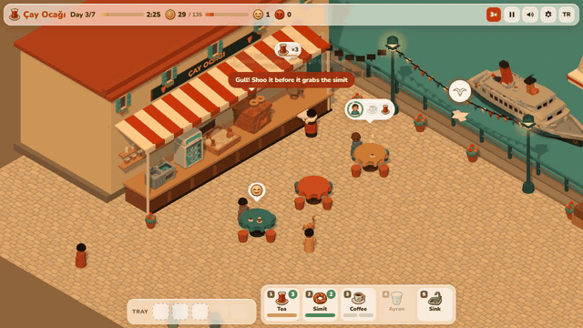
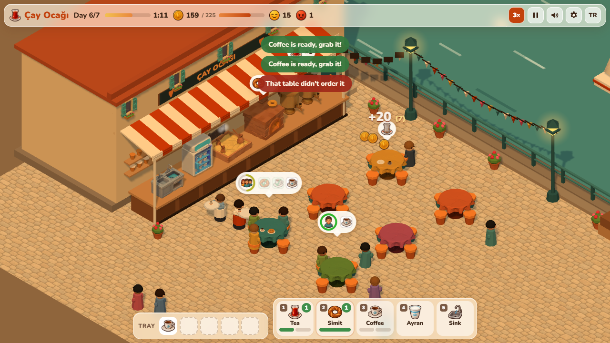
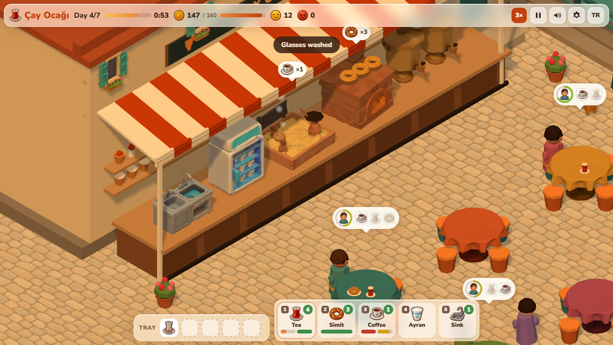
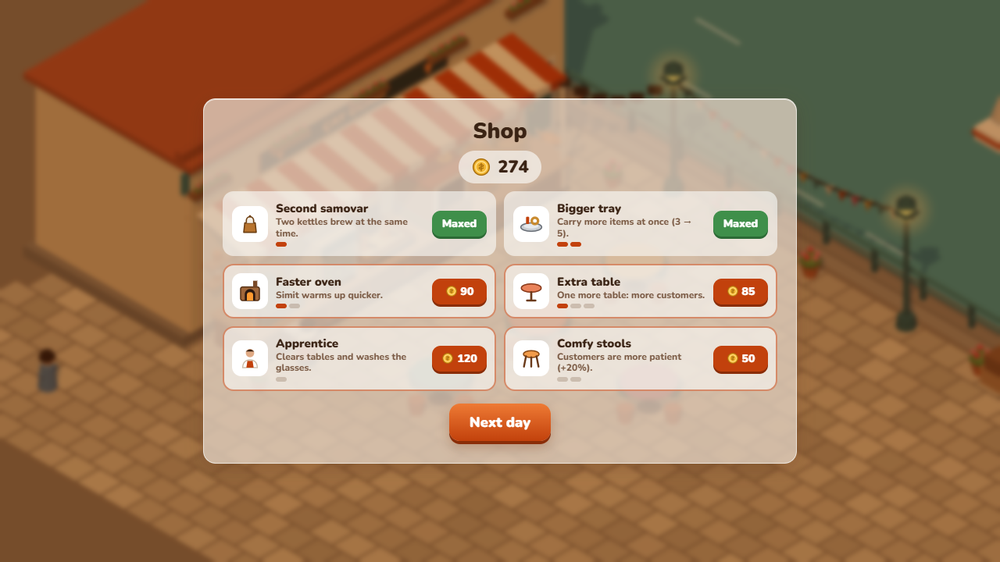
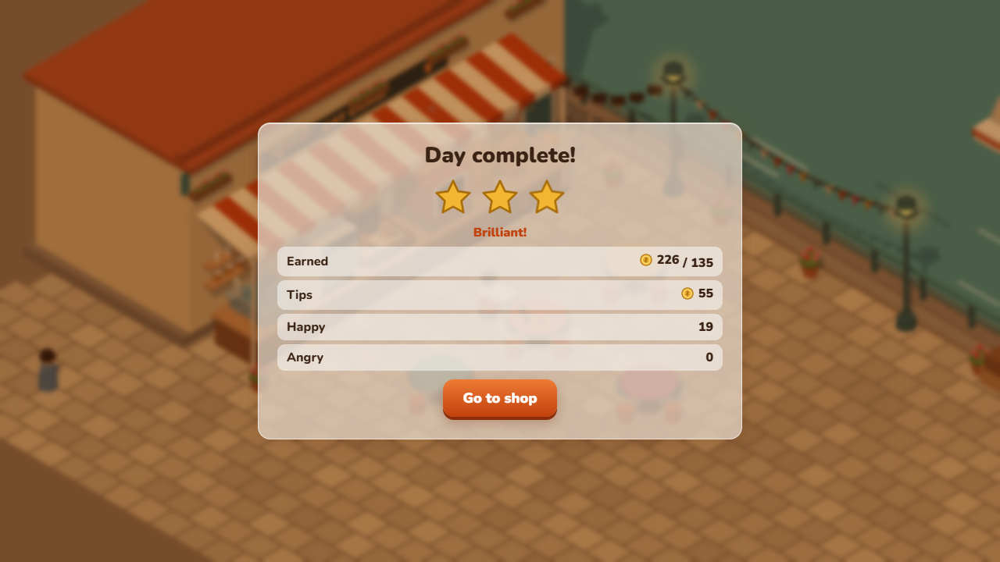
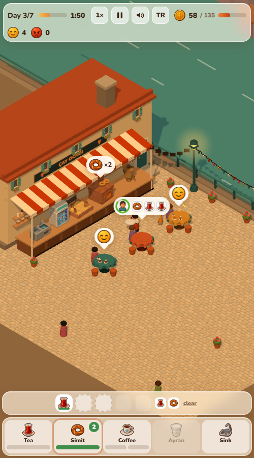
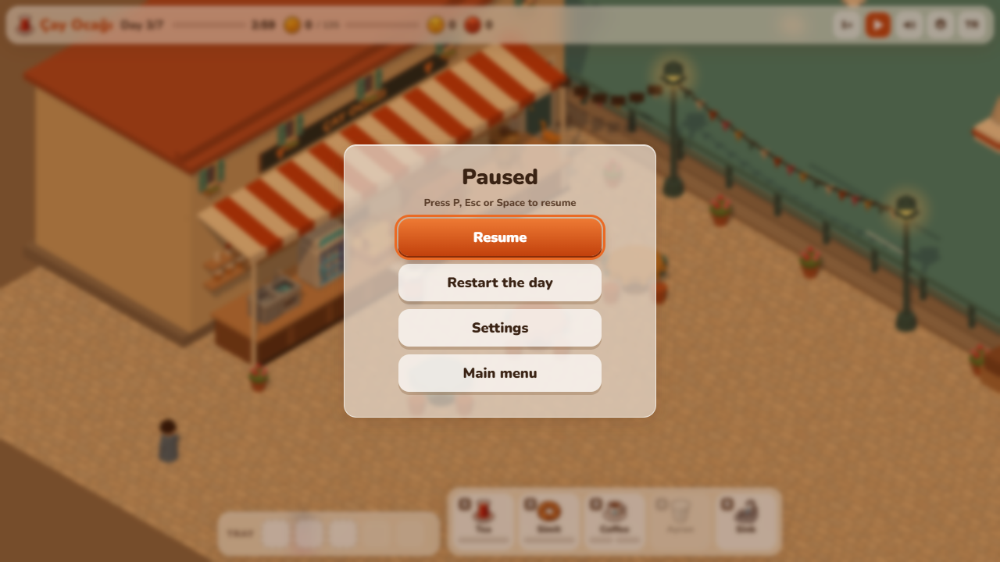
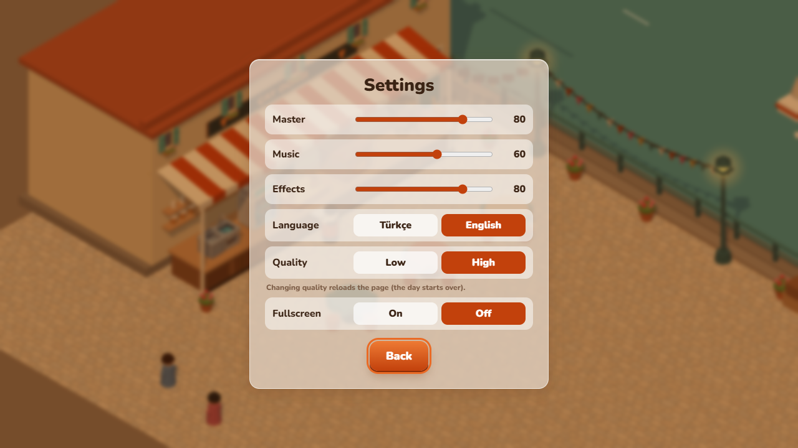
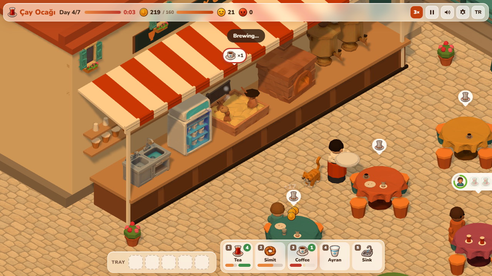
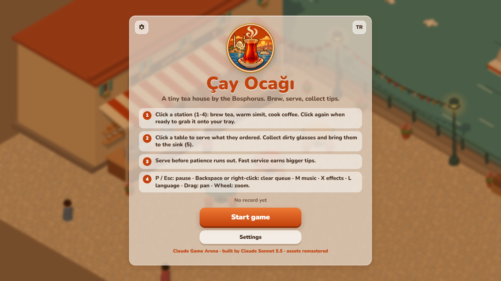

# 🍵 Çay Ocağı · Tea House Rush

**[▶ Play in your browser](https://furkiozknn.github.io/cay-ocagi/)** · Türkçe & English · desktop & mobile · free, no install

🏟️ Part of **[Claude Game Arena](https://furkiozknn.github.io/)**: four games, each built by a different Claude model. This is game #2, built by **Claude Sonnet 5.5**; assets remastered by **Claude Opus 5.5** (orchestrator). [See all games and the scorecard →](https://furkiozknn.github.io/)

🎮 **Godot 4 remake (round 2):** [play](https://furkiozknn.github.io/cay-ocagi-godot/) · [code](https://github.com/Furkiozknn/cay-ocagi-godot), rebuilt by the same model in a real game engine.

A low-poly 3D time-management game in a **single `index.html`** (Three.js, no build step) plus a small `assets/` folder of generated models, icons and one texture.
Run a tiny tea house on an Istanbul quay for seven busy days: brew tea, warm simit, cook Turkish coffee
without letting it boil over, serve every table before patience runs out, and keep the glasses washed.

## Features

- **Four menu items, each with its own station:** tea has to brew in the semaver, simit warms in the oven,
  Turkish coffee must be grabbed in time or it boils over, ayran is instant. Dirty glasses go to the sink.
- **Seven days, each adding something new:** a new menu item, a hurried office worker with little patience,
  a group of three, a regular who tips double. Coin target and 1-3 stars per day, then an endless shift.
- **Shop between days:** second semaver, bigger tray (3 → 5 items), faster oven, an apprentice who clears tables,
  extra tables, comfy stools (+20% patience).
- **Tips depend on speed.** Customers who wait too long leave angry; customers who find no free table walk by.
- **A living street:** a ferry crossing the strait, seagulls, lamp posts, bunting, geraniums and a cat you can pet.
- **Generated assets on a procedural base:** the stations, tables, windows, ferry, cat, ground texture and the icon set
  are generated models and images; the rest of the scene, the characters and every sound effect (Web Audio) are made in code.
- **Pause menu, settings and saved progress:** pause (`P` / `Esc`) to resume, restart the day, open the settings or go
  back to the main menu. Settings: master, music and effects volume, Türkçe / English, Low / High quality, fullscreen.
  The run is saved at the start of every day and at every shop visit, so **Continue** on the title picks it up after a reload.
- **Music:** a small hicaz loop with a frame drum (the same notes as the Godot remake), synthesised with Web Audio.
- **Fair closing time:** "last orders" is announced 20 s before closing (the clock turns red); tables that are still
  eating when the day ends pay their bill and tip.
- **Light on the GPU:** 31 draw calls and about 50 k triangles on a busy day 6, 60 fps on an Intel UHD 620 laptop at
  1280×720 (measured in Chrome). Use Low quality or `?low` if it stutters.

| | |
|---|---|
|  |  |
|  |  |
|  |  |

## Controls

| Action | Mouse / keyboard | Touch |
|---|---|---|
| Use a station (brew, collect, wash) | Click it, or keys `1`-`5` | Tap the station or its button |
| Serve or clear a table | Click the table or its order bubble | Tap |
| Drop an item from the tray (not dirty glasses: they go to the sink) | Click the tray slot | Tap |
| Clear the walking queue | `Backspace` or right-click | — |
| Pan / zoom | Drag / mouse wheel | Drag / pinch |
| Pause menu | `P`, `Esc` or `Space` | Pause button |
| Music on/off · effects on/off · language | `M` · `X` · `L` | Settings |
| Fullscreen | `F11` or Settings | Settings |
| Menus | `Tab` to move, `Enter` / `Space` to press (visible focus ring) | Tap (buttons are at least 44 px) |

The waiter walks to each target in order; you can queue up to six clicks. Station and table clicks are ignored while paused.

## Settings and saves

Settings are stored in the browser (`localStorage` key `arena.cay.settings`: master / music / effects volume, language,
quality); the saved run is `arena.cay.save` and the best result `arena.cay.best` (the old `cay_prefs` / `cay_best`
keys are read once and migrated). Changing quality reloads the page. A failed day keeps the coins it earned and the
retry goes through the shop, so you can buy an upgrade before trying the same day again.

## Run it locally

Download the repo and double-click `index.html` (it needs internet the first time, to load Three.js and the font from a CDN),
or serve the folder with `python -m http.server 8766` and open http://127.0.0.1:8766/. Double-clicking shows the original
procedural 3D models with the generated icons (browsers block loading model files from `file://`); serve the folder to see
the generated models too.

### URL flags

| Flag | Effect |
|---|---|
| `?low` | No shadows, half the particles |
| `?lang=en` / `?lang=tr` | Interface language |
| `?auto` | The game plays itself at 3× speed (self-test bot) |
| `?debug` | Draw calls, fps and any JS errors on screen; `window.caySim(seconds)` fast-forwards the simulation |
| `?sim=N` | Fast-forwards N seconds before the first frame |
| `?bench=N` | Runs N full bot games and prints per-day results (with `?auto&debug`) |
| `?noassets` | Original procedural look, without the generated models, icons and texture |
| `?nosave` | Do not read or write the saved run (implied by `?auto`, `?bench` and `?clicktest`) |
| `?day=N` | Start a new game on day N (with 150 coins per skipped day) |

## How it was made

Game #2 of a series in which **every game is built by a different AI model**, to compare which one makes the better game.
This one was built by **Claude Sonnet 5.5** (`claude-sonnet-5-5`) with [Claude Code](https://claude.com/claude-code), on its own,
from one prompt: [`prompts/cay-ocagi.md`](prompts/cay-ocagi.md). Every model gets the same prompt structure, quality bar and
self-test rule, and none of them sees the other games' code. The orchestrating session (Claude Opus 5.5) wrote the prompt,
re-tested the result independently and published it.

Verification before release: the self-test bot played 30 full games (26 wins; it is pushed on days 5 and 7, while a deliberately
slow bot loses around days 3-5), an independent run reached the endless shift with zero JS errors, plus screenshot checks of every
screen in Turkish and English and a 390 px phone layout.

| # | Game | Genre | Model |
|---|---|---|---|
| 1 | [Hisar](https://github.com/Furkiozknn/kale-savunmasi) | Tower defense, 3D | Claude Opus 5.5 |
| 2 | **Çay Ocağı** | Time management, 3D | Claude Sonnet 5.5 |
| 3 | [Çini Ustası](https://github.com/Furkiozknn/cini-ustasi) | Puzzle, 3D | Claude Fable 5.1 |
| 4 | [Martı](https://github.com/Furkiozknn/marti) | Arcade flyer, 3D | Claude Haiku 5.5 |

## Assets

The first version made everything in code. The remaster replaced the weakest parts with generated assets, made with
[Higgsfield](https://higgsfield.ai): **Tripo** text-to-3D for the semaver, simit oven, coffee sand stove, ayran cooler,
sink, tables, façade windows, ferry and cat, and **GPT Image** for the icon set, the logo and the cobblestone texture.
Models were processed with [glTF-Transform](https://gltf-transform.dev/) (centred, textures resized to WebP); in total
about 0.9 MB. The served items (tea glass, simit, coffee and ayran cups) are small models built in code.
The procedural builders stay as the fallback: opened from `file://` (where the browser blocks loading model files) the
game uses its original 3D models with the generated icons; with `?noassets`, or if an icon file is missing, it uses the
original drawn icons too. Details, prompts and checks: [`docs/assets.md`](docs/assets.md).

| | |
|---|---|
|  |  |

## Changelog

### 2026-10-21 overnight pass

Done by Claude Opus 5.5 after a code review of the remastered build; game rules and balance are unchanged except for the
bug fixes listed here.

- **Fixes**
  - Parties that were fully served and still eating at closing time were dropped without paying; they now pay their
    bill and tip when the day ends.
  - Dirty glasses could be thrown away from the tray, skipping the sink; now only clean items can be dropped.
  - Wheel zoom and pinch resized the canvas on every event; zooming now only changes the camera.
  - A pinch could end in a click on the table under the fingers; it no longer does.
  - The game-over button now says "Shop & retry" (it opens the shop before the retry).
  - The waiter clearing a table the apprentice was walking to left the apprentice "clearing" a clean table; the
    apprentice now turns back.
  - Station and table clicks (and keys 1-5) no longer queue work while paused.
  - The title card no longer re-animates once per loaded asset (only the Play button label changes while loading).
  - The icon PNGs and the logo are preloaded (counted in "Loading… n/N"); if any is missing, the drawn icons stay.
  - The boiled-over coffee is now a wide dark froth on the pot (it could sit below the counter top before); its steam
    burst comes from the pot on the stove model.
  - The top bar uses the tea glass icon (the detailed logo was unreadable at 26 px).
  - `?day=8` and later now start in the endless shift (the HUD showed "Day 8/7"); `?audiotest` no longer crashes without
    Web Audio; the error list is capped for promise rejections too; replaced models and materials are disposed.
- **New systems**: pause menu (Resume / Restart the day / Settings / Main menu over the blurred game), settings panel
  (master / music / effects volume, language, Low / High quality, fullscreen), saved run with Continue and a
  "new game overwrites your save" check, new-record highlight on the end screens, Main menu on the summary, shop and
  intro screens, keys `P`/`Esc` pause, `M` music, `X` effects, `L` language, `Backspace` clear queue, keyboard focus on
  menu buttons with a visible ring, 44 px touch targets, footer link to Claude Game Arena, `?nosave`.
- **Redesign**: a hicaz music loop on its own volume bus (ducked while paused), "last orders" toast and red clock for the
  last 20 s, coins that fly from the paying table to the coin counter.
- **Removed code**: unused `itemIcon`, `A.retry` (replaced by the pause menu's restart), `ambient`, `autoPaused`, the
  `water` particle, two unused halo slots, a duplicated cat rotation, empty handlers, unused CSS and 13 unused text keys;
  the hidden table-leg instances are no longer uploaded every frame, and per-frame DOM lookups and colour allocations
  were cached.

## Tech

Three.js r170 (ES module from jsDelivr, GLTFLoader for the models), Web Audio API, one Google Font. About 2,500 lines of plain JavaScript, HTML and CSS in one file.

## License

Code: [MIT](LICENSE).
